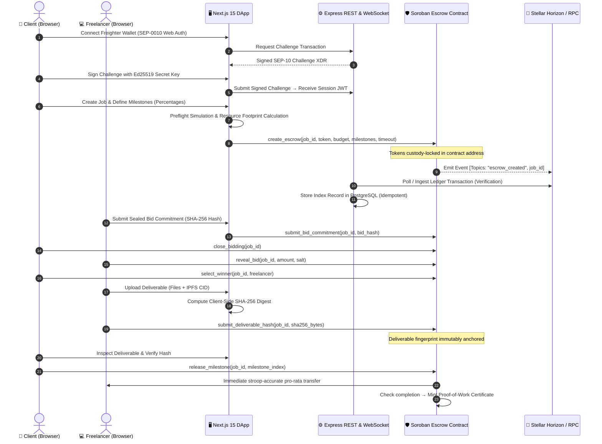

# 💜 Stellar PurplePay

> **Non-custodial escrow, milestone-based settlements, and decentralized freelance marketplace infrastructure powered by Soroban smart contracts on the Stellar network.**
>
> **Post. Work. Get Paid. Trustless commerce with zero platform middlemen and sub-second settlement.**

---

[](https://github.com/Stellar-PurplePay/Stellar-PurplePay/actions/workflows/ci.yml)
[](https://stellarpurplepay.vercel.app)
[-success)](SECURITY.md)
[](https://stellar.org)
[](https://stellar.expert/explorer/testnet/contract/CDNSSLIZOZOQ6UM6PIFWSSCGZEZ4APW3N4GXMOCVXTB5IX3M4K3NP26X)
[](https://stellarpurplepay.vercel.app/.well-known/stellar.toml)
[](https://stellarpurplepay.vercel.app/api/auth/challenge)
[](LICENSE)
[](CONTRIBUTING.md)

Stellar PurplePay is an open-source decentralized freelance marketplace and programmable payment protocol that eliminates payment defaults, exorbitant platform commissions (up to 20% on Web2 platforms), and non-transparent dispute mediation. By anchoring contractual budgets into trustless **Soroban smart contract escrows**, clients and service providers transact with mathematical finality, milestone-based pro-rata disbursements, and cryptographic proof-of-work deliverable verification.

---

## 🏷️ Repository Tags & Metadata

```text
stellar, soroban, smart-contracts, escrow, freelance-marketplace, freighter, sep-10, sep-01, rust, typescript, nextjs, pwa, dapp
```

---

## 🌐 Live Deployments & On-Chain Verification

| Component | Target / Environment | Live URL / Explorer Link |
| :--- | :--- | :--- |
| **Production Web App** | Vercel Edge Network | [**stellarpurplepay.vercel.app**](https://stellarpurplepay.vercel.app) |
| **SEP-0001 Discovery** | `.well-known/stellar.toml` | [**stellarpurplepay.vercel.app/.well-known/stellar.toml**](https://stellarpurplepay.vercel.app/.well-known/stellar.toml) |
| **Soroban Smart Contract** | Stellar Testnet | [`CDNSSLIZOZOQ6UM6PIFWSSCGZEZ4APW3N4GXMOCVXTB5IX3M4K3NP26X`](https://stellar.expert/explorer/testnet/contract/CDNSSLIZOZOQ6UM6PIFWSSCGZEZ4APW3N4GXMOCVXTB5IX3M4K3NP26X) |
| **Interactive Console** | Stellar Lab Explorer | [View in Stellar Lab](https://lab.stellar.org/r/testnet/contract/CDNSSLIZOZOQ6UM6PIFWSSCGZEZ4APW3N4GXMOCVXTB5IX3M4K3NP26X) |
| **Deploy Transaction** | Stellar Testnet | [`8f0442f2a273464628...`](https://stellar.expert/explorer/testnet/tx/8f0442f2a273464628600ab1eabd2bedfcd987e98c8f8b1747d833fff4532ebf) |
| **Admin / Treasury Key** | Stellar Testnet | `GBWFZHBYEKF5MR2MHW7JAZX6ZRI2PKKBL6IALEMJSBMU4JMDSIB34KP5` |
| **Contract SemVer** | On-Chain Version | `1.1.0` |
| **Horizon RPC** | Stellar Testnet | `https://horizon-testnet.stellar.org` |
| **Soroban RPC** | Stellar Testnet | `https://soroban-testnet.stellar.org` |

---

## 📸 Interface Previews & User Experience

```text
┌────────────────────────────────────────────────────────────────────────────────────────┐
│  💜 Stellar PurplePay — Decentralized Escrow & Talent Marketplace                     │
├────────────────────────────────────────────────────────────────────────────────────────┤
│                                                                                        │
│  [ Explore Jobs ]   [ Post a Project ]   [ DAO Arbitration ]   [ Connect Freighter ]   │
│                                                                                        │
│  ┌──────────────────────────────────────────────────────────────────────────────────┐  │
│  │ 💼 Senior Soroban Protocol Engineer                        [ Active Escrow: 100% ]│  │
│  │ Client: GBWF...4KP5  ·  Budget: 3,500 USDC  ·  Timeline: 30 Days                 │  │
│  │                                                                                  │  │
│  │ Milestone 1: Smart Contract Architecture & State Machine     (35% - Released) ✓  │  │
│  │ Milestone 2: Multi-Sig Quorum Arbitration & Bond Slicing    (35% - In Review) ⏳ │  │
│  │ Milestone 3: End-to-End Integration Tests & Deployment       (30% - Locked)    🔒 │  │
│  │                                                                                  │  │
│  │ Deliverable SHA-256: 7d4a1ef982b6c3104e57d19...  ·  IPFS: QmZtmD2qt...           │  │
│  │ [ Verify On-Chain Hash ]   [ Approve Milestone ]   [ Request Mutual Extension ]  │  │
│  └──────────────────────────────────────────────────────────────────────────────────┘  │
│                                                                                        │
│  ⚡ Network Status: Stellar Testnet (Ledger #482910)  ·  Base Fee: 100 stroops (0.00001)│
└────────────────────────────────────────────────────────────────────────────────────────┘
```

---

## 🏗️ Architecture & Escrow State Machine

### System Topology & Interaction Flow



---

## 🛡️ Stellar Ecosystem Standards (SEP) Deep-Dive

PurplePay implements official **Stellar Ecosystem Proposals** across its full stack:

### 1. SEP-0001: Machine-Readable Stellar TOML (`/.well-known/stellar.toml`)
- Discovered at `https://stellarpurplepay.vercel.app/.well-known/stellar.toml`
- Serves verified platform metadata, network passphrase (`Test SDF Network ; September 2015`), signing key (`GBWF...4KP5`), Horizon endpoints, currency parameters, and Soroban contract addresses.
- Built with cross-origin headers (`Access-Control-Allow-Origin: *`) for frictionless indexing by wallets and ecosystem scrapers.

### 2. SEP-0010: Cryptographic Stellar Web Authentication
- Passwordless, secure wallet login adhering to RFC-compliant challenge transaction signing.
- Eliminates insecure session cookies and spoofable wallet headers. The backend derives authenticated public keys solely from verifiable ed25519 signatures.

### 3. SEP-0007: Delegated URI Signing (`web+stellar`)
- Cross-platform transaction requests supporting mobile hardware wallets and external Stellar signers.

### 4. SEP-0041: Soroban Token Standard
- Strict compliance with Soroban's native token interface (`token::Client`).
- Supports native **XLM** and fiat-pegged **USDC** with precision-guarded integer arithmetic (stroops).

---

## 📜 Soroban Smart Contract Specification

The primary escrow contract (`contracts/purplepay-contract`) exposes the following audited entrypoints:

| Function Signature | Auth Constraint | Description |
| :--- | :--- | :--- |
| `initialize(admin, treasury, fee_bps)` | `admin.require_auth()` | Sets immutable admin, treasury address, and platform fee (capped at 10% ceiling). |
| `create_escrow(job_id, token, amount, milestones, timeout)` | `client.require_auth()` | Locks client funds in contract balance, initializes milestone records, and sets timeout. |
| `submit_bid_commitment(job_id, commitment_hash)` | `freelancer.require_auth()` | Commits a hashed sealed bid without exposing amount or pricing details. |
| `reveal_bid(job_id, amount, salt)` | `freelancer.require_auth()` | Reveals bid details; contract verifies `SHA256(amount + salt) == commitment_hash`. |
| `select_winner(job_id, freelancer)` | `client.require_auth()` | Awards contract to chosen freelancer, transitioning escrow to `InProgress`. |
| `submit_deliverable_hash(job_id, sha256_hash)` | `freelancer.require_auth()` | Anchors cryptographic proof-of-work fingerprint to contract storage. |
| `release_milestone(job_id, milestone_idx)` | `client.require_auth()` | Releases milestone funds pro-rata to freelancer, deducting platform fee to treasury. |
| `timeout_refund(job_id)` | Permissionless | Automatically refunds unreleased funds to client if ledger timestamp exceeds deadline. |
| `dispute_escrow(job_id)` | Counterparty Auth | Freezes milestone releases and refers contract to designated DAO arbitrator. |
| `resolve_dispute(job_id, client_amt, freelancer_amt)` | `arbitrator.require_auth()` | Executes final split settlement with dust-free conservation of escrow funds. |

---

## 🗂️ Project Repository Structure

```text
Stellar-PurplePay/
├── frontend/                  # Next.js 15 + React 18 + Tailwind CSS PWA Application
│   ├── components/            # Accessible UI components (Freighter connector, Modals, Escrow Stepper)
│   ├── contexts/              # Price, theme, and authentication providers
│   ├── hooks/                 # Custom React hooks (SWR queries, shortcuts, timers, preflight)
│   ├── lib/                   # API client layer, Stellar SDK helpers, and wallet bridge
│   ├── pages/                 # Next.js route pages (Marketplace, Dashboard, DAO, Jobs)
│   └── public/                # Static assets, PWA manifest, and .well-known/stellar.toml
├── backend/                   # Node.js + Express + PostgreSQL REST & WebSocket Service
│   ├── src/                   # Routes, controllers, middleware, and on-chain verification
│   │   ├── routes/            # Authenticated REST routes (Escrow, Jobs, Profiles, Admin, Health)
│   │   ├── services/          # contractAuditService, escrowService, stellarTrustlineService
│   │   ├── middleware/        # JWT auth, role validation, rate limiting, magic bytes
│   │   └── db/migrations/     # 77 Sequential idempotent SQL migrations (V1–V80)
│   └── tests/                 # Unit, integration, and security regression test suites
├── contracts/                 # Soroban Smart Contracts (Rust / WebAssembly)
│   ├── purplepay-contract/    # Primary non-custodial escrow & milestone settlement contract
│   │   ├── src/               # lib.rs, admin.rs, storage.rs, types.rs, errors.rs
│   │   └── tests/             # Unit and integration test suites
│   └── arbitrator-registry/   # DAO arbitrator pool, voting, and dispute governance contract
├── docker-compose.yml         # One-command development environment (Postgres, Redis, Backend, Frontend)
├── docker-compose.prod.yml    # Hardened production container stack (isolated loopback ports)
├── docs/                      # Technical specifications, ADRs, and API documentation
└── .github/                   # Automated CI/CD pipelines (Rust, Clippy, Node 18/20 Matrix, E2E)
```

---

## ⚡ Quick Start: One-Command Docker Setup

The easiest way to run the entire stack locally (PostgreSQL, Redis, Backend API, and Next.js Frontend):

```bash
# 1. Clone repository
git clone https://github.com/Stellar-PurplePay/Stellar-PurplePay.git
cd Stellar-PurplePay

# 2. Launch complete environment
docker compose up -d

# 3. Verify services
docker compose ps
```

* **Frontend:** [http://localhost:3000](http://localhost:3000)
* **Backend API:** [http://localhost:4000](http://localhost:4000)
* **Health Check:** [http://localhost:4000/api/health](http://localhost:4000/api/health)
* **PostgreSQL:** `localhost:5432` (`stellarwork` / `stellarwork_dev`)

---

## 🛠️ Manual Development Setup

### System Prerequisites
* **Node.js**: `>= 20.x`
* **Rust & Cargo**: `>= 1.74` with `wasm32v1-none` target
* **PostgreSQL**: `>= 15.x`
* **Freighter Wallet**: Browser Extension ([freighter.app](https://www.freighter.app))

### 1. Backend Setup
```bash
cd backend
npm install
cp .env.example .env
npm run migrate
npm run dev
```

### 2. Frontend Setup
```bash
cd ../frontend
npm install
cp .env.example .env.local
npm run dev
```

### 3. Smart Contracts (Build & Test)
```bash
cd ../contracts/purplepay-contract
cargo fmt --check
cargo clippy --all-targets -- -D warnings
cargo test
cargo build --target wasm32v1-none --release
```

---

## 🧪 Comprehensive Quality Assurance & Testing

```bash
# Frontend Unit, Component, and Snapshot Tests (125 Suites, 712 Tests)
cd frontend
npm test

# Backend Unit and Integration Tests (Supertest + PostgreSQL)
cd ../backend
npm test
npm run test:integration

# End-to-End User Flow Tests (Playwright Chromium)
cd ../frontend
npm run test:e2e

# Smart Contract Rust Tests (47 Unit and Property Invariant Tests)
cd ../contracts/purplepay-contract
cargo test
```

---

## 📜 Community, Standards & Security

- **[Changelog](CHANGELOG.md)** — Detailed record of releases, audit remediations, and protocol upgrades.
- **[Observability & Metrics](backend/docs/METRICS.md)** — Prometheus metrics, operational dashboards, and alerting rules.
- **[Code of Conduct](CODE_OF_CONDUCT.md)** — Contributor Covenant 2.1 standards for an inclusive community.
- **[Contributing Guidelines](CONTRIBUTING.md)** — Architecture conventions, branch standards, and PR requirements.
- **[Security Policy](SECURITY.md)** — Responsible disclosure policy, private advisory channels, and response SLAs.
- **[License](LICENSE)** — Permissive **MIT License**.

---

## 👥 Stewardship & Ecosystem Mission

Maintained with 💜 by the **Stellar PurplePay Community**. Built to unlock trustless global commerce and showcase the power of **Soroban smart contracts on the Stellar network**.
